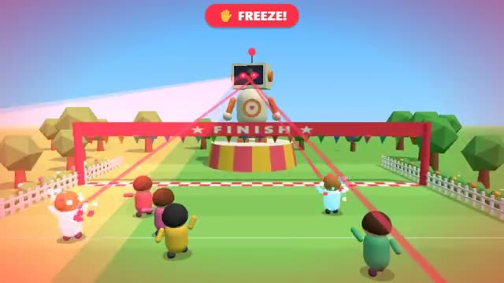

# Red Light

Run while the robot sings. Freeze when it turns. A multiplayer starter game from [Multiplayer Agent](https://multiplayeragent.com): 3D, party, 2–20 players, with bots that fill empty seats.

## How it plays

Hum-Bot sings with its back to you: run for the finish line. When the song ends it turns round, and anyone it sees moving gets zapped back to the start. Songs are different lengths and it fakes you out, so watch the notes.

**Controls:** WASD, arrows or Space (or hold the mouse) to run, let go to stop; on touch, hold and push the stick.

## Make it yours in the Game Builder

Open the [Game Builder](https://multiplayeragent.com), choose **Start from a starter game** and pick Red Light. It opens as version 1 in your studio, ready to play and publish. Then ask for changes, for example:

- Make the robot a giant scarecrow in a pumpkin field
- Add a bush halfway down that hides you from the robot
- Give the robot a second, faster song in the last 20 seconds

## Run it yourself

1. Get a free publishable key (`pk_…`) at [multiplayeragent.com](https://multiplayeragent.com).
2. In `index.html`, put it in place of `pk_REPLACE_ME` in the `MP_CONNECT` block.
3. Serve the folder (for example `npx serve`) and open it. The 3D engine loads as a module, which browsers block from a file on disk.

Without a key it still runs, offline against bots.

## How it is built

- One `index.html` plus three.js in `libs/`. The comment at the top of the script maps the code and explains the multiplayer.
- **Host-run rounds:** The host's browser runs the robot's songs and stares, decides every zap and finish and keeps the times; if it leaves, the next player takes over.
- **Bots:** Bot runners fill the field, and sometimes stop a moment too late.
- **Live sync:** Every runner, every zap and the robot's turn are the same for everyone.
- **Leaderboard:** The fastest runs to the finish line.
- `?attract` runs it offline with bots only. The preview video is recorded from it.

## License

MIT. three.js in `libs/` is MIT too (Copyright 2010-2024 three.js authors).
